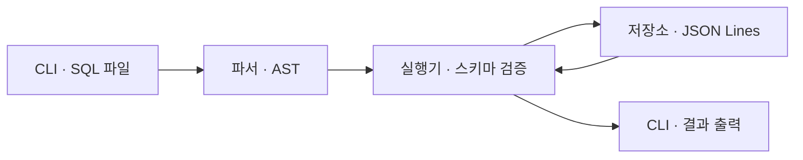

# mini-DBMS

SQL 파일을 받아 파싱·검증·실행하고, 데이터를 파일에 저장하는 Python 미니 DBMS입니다. 파일 기반 SQL 처리기에서 시작해 B+ 트리 인덱스와 스레드 풀 기반 API 서버로 확장합니다.

이 README는 **yeongeun-main 브랜치의 현재 구현을 정리한 초안**입니다.

## 진행 상태

| 단계 | 목표 | 현재 상태 |
| --- | --- | --- |
| Phase 1 | CLI + INSERT / SELECT + 파일 저장 | 구현, 단위·CLI 기능 테스트 35개 통과 |
| Phase 2 | 메모리 B+ 트리 + 100만 건 이상 검색 성능 비교 | 학습·설계 중, 미구현 |
| Phase 3 | 기존 엔진을 사용하는 API + 스레드 풀 | 미구현 |

Phase 1에서 자동 ID를 먼저 구현했습니다. 현재 ID 조회도 전체 스캔을 사용하며, B+ 트리 탐색과 성능 측정 결과는 아직 없습니다. [과제 원문](docs/assignment.md)

## 빠른 실행

저장소 루트에서 실행합니다. 외부 패키지 설치는 필요하지 않습니다. 검증 환경은 **Windows · Python 3.13.14**입니다.

```powershell
python -m mini_dbms init --data-dir data
python -m mini_dbms run examples/phase1.sql --data-dir data
```

init은 빈 users.jsonl을 준비하며 기존 파일을 덮어쓰지 않습니다. 예제를 다시 실행하면 새 ID로 행이 추가됩니다. 자세한 출력·종료 코드와 실행 규칙은 [실행 방법](docs/usage.md)에 있습니다.

## 구현한 기능

- SQL 파일의 문장을 순서대로 파싱·검증·실행
- INSERT 시 자동 ID 부여와 JSON Lines 파일 끝 추가
- SELECT의 전체 조회·컬럼 선택·동등 조건 하나
- 시작 시 저장 파일 전체 검증과 다음 ID 복원
- 첫 오류 후 실행 중단, 앞선 성공 데이터 유지
- 손상·입력·문법·스키마·저장·출력 오류 구분

### 지원 SQL과 스키마

```sql
INSERT INTO users (name, age) VALUES ('영희', 25);
INSERT INTO users (age, name) VALUES (28, 'O''Brien');
SELECT * FROM users;
SELECT name, age FROM users;
SELECT name FROM users WHERE id = 1;
```

| 컬럼 | 자료형 | 규칙 |
| --- | --- | --- |
| id | 양의 64비트 정수 | 엔진이 1부터 자동 부여, 직접 입력 불가 |
| name | 문자열 | INSERT에 필수 |
| age | 부호 있는 64비트 정수 | INSERT에 필수 |

컬럼 순서는 바꿀 수 있습니다. SQL 문장은 문자열 밖 세미콜론으로 끝내며, 문자열 속 작은따옴표는 두 번 씁니다. 자동 형 변환·NULL·SQL 주석·여러 행 VALUES·복합 조건·JOIN·집계·정렬은 지원하지 않습니다. 스키마는 코드에 정의되어 있으며 CREATE TABLE·UPDATE·DELETE도 구현 범위에 포함하지 않았습니다.

### 저장 형태

data/users.jsonl에 한 행씩 UTF-8 JSON과 LF를 기록합니다.

```json
{"id":1,"name":"영희","age":25}
{"id":2,"name":"O'Brien","age":28}
```

재시작할 때 JSON 문법, 컬럼·자료형, ID 증가 순서, 레코드 경계를 검사합니다. ID 공백은 허용하고 중복·역순은 거부합니다. 검사가 끝난 뒤 최대 ID + 1부터 이어갑니다.

## 처리 흐름과 책임



파서는 문법과 값의 종류를 해석합니다. 실행기는 스키마를 검증하고 조건·출력 컬럼을 처리합니다. 저장소는 파일 I/O와 ID를 관리합니다. SELECT는 저장소에서 한 행씩 받아 검사하므로 테이블 전체를 먼저 리스트로 만들지 않습니다.

| 선택 | 이유와 비용 |
| --- | --- |
| Python 표준 라이브러리 | 문자열·가변 자료구조의 메모리 관리 부담을 줄이고 처리 로직과 검증에 집중. 실제 메모리 배치를 정밀하게 제어하는 학습은 별도 |
| JSON Lines | 저장된 컬럼과 값을 직접 확인하고 표준 JSON 처리 사용. 컬럼 이름 반복으로 파일이 커질 수 있음 |
| 시작 시 전체 검사 | 저장 데이터의 문제와 다음 ID를 함께 확인. 데이터가 많으면 시작 시간이 늘어남 |
| 첫 오류 후 중단 | 실패에 의존하는 후속 SQL 실행을 방지. 이미 성공한 문장을 취소하는 기능은 아님 |

## 실패 처리와 보장 한계

INSERT는 행 전체와 줄바꿈 기록 후 **flush가 성공하면 저장 성공**으로 반환합니다. 잘못된 SQL·스키마 입력은 파일 변경 전에 거부합니다.

쓰기 도중 실패하면 일부 데이터가 남을 수 있습니다. 오류를 알리고 저장소 사용을 중단하며 원본은 자동 삭제·수정하지 않습니다. 다음 시작 때 손상을 발견해도 건너뛰지 않고 중단합니다.

저장 후 결과 출력에 실패해도 데이터는 이미 남아 있을 수 있습니다. 오류 안내에 따라 재실행 전에 조회해야 합니다. SELECT도 일부 결과 출력 뒤 실패할 수 있으며 완료 표시·종료 코드로 구분합니다.

현재 지원 조건은 **단일 프로세스 접근**입니다. fsync에 의한 내구성 강화, 전원 장애 자동 복구, 여러 SQL의 트랜잭션 전체 취소, 자동 재시도 중복 방지는 구현하지 않았습니다.

## 검증

```powershell
python -W error::ResourceWarning -m unittest discover -v
python -m compileall -q mini_dbms tests
```

2026-11-18 검증 기록: **35개 테스트 통과**, 구문 검사 통과. 파서·스키마·저장소·실행기와 별도 프로세스 CLI를 검사했습니다. 재시작 ID 복원, 기존 파일 보존, 첫 실패 중단, 손상 입력, 부분 쓰기·flush 실패, 출력 실패도 포함합니다. 실제 전원 차단·대용량 성능은 검증하지 않았습니다. [검증 상세](docs/study/04-verification.md)

## 문서와 다음 단계

- [실행 방법](docs/usage.md)
- [Phase 1 설계](docs/design/phase-1.md)
- [학습 목차](docs/study/00-overview.md)
- [DBMS 등장 배경·파일시스템과의 차이](docs/study/01-dbms-background.md)
- [B+ 트리 학습·현재 결정](docs/study/phase-2/02-b-plus-tree.md)
- [파일·인덱스 연결과 실패 정책](docs/study/phase-2/03-index-integration.md)

Phase 2에서는 리프에 ID → 파일 시작 바이트 위치를 등록하고 ID 동등 조회에 활용합니다. 파일 저장 후 인덱스 등록에 실패하면 성공 응답 없이 오류를 알리고 이후 DB 작업을 중단하며, 재시작 때 파일 검증과 함께 인덱스를 재구성하는 방향으로 설계 중입니다.
